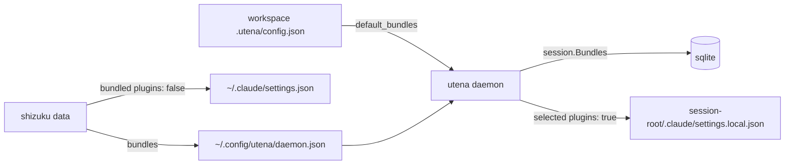

# Plugin Bundles — Design

Date: 2026-10-16

## Problem

Every Claude Code plugin is enabled in `~/.claude/settings.json`, so every
session loads every plugin's skills, hooks and MCP servers whether or not they
are relevant. We want most plugins off by default and turned on per session in
named bundles ("go", "docs", …).

Claude Code has no built-in bundle/profile concept, but `enabledPlugins` merges
key by key across scopes, and local scope (`.claude/settings.local.json`)
overrides user scope in both directions. Sessions are always launched from the
session root, and utena already writes `<session-root>/.claude/settings.local.json`.

## Decisions

- **Selection:** workspace defaults + per-session override. Each workspace's
  `.utena/config.json` lists default bundles; a new session starts with the
  union of its workspaces' defaults, editable in the form and session detail.
- **Catalog:** utena owns the schema; shizuku writes the user's specific
  bundles into utena's config.
- **Default off:** shizuku sets bundled plugins `false` in user settings. utena
  only writes `true` for selected plugins. Bundled plugins are therefore off in
  non-utena Claude sessions too.
- Bundles hold plugins only (YAGNI on MCP servers, env, etc.).

## Architecture



### Catalog (utena schema)

`daemon.json` gains a `bundles` key, loaded into `api.Config` the same way
`browser` is:

```json
{
  "browser": "firefox",
  "bundles": {
    "go":   { "plugins": ["go@eleonorayaya-claude-code", "go-patterns@eleonorayaya-claude-code"] },
    "docs": { "plugins": ["docs@...", "pdf@..."] }
  }
}
```

Each bundle is an object so fields like `description` can be added later
without a format change.

### Workspace defaults

`WorkspaceConfig` gains `default_bundles []string` (JSON `default_bundles`)
alongside `setup_actions`.

### Session state

`Session` gains `Bundles []string` with `gorm:"serializer:json"`, the same
pattern as `mux.Session.Env` and `browser.Window.Tabs`.

### shizuku

- `claude.Options` gains `Bundles map[string][]string`.
- The claude app writes `false` to user settings for every bundled plugin not
  in `AlwaysOnPlugins`. `AgentConfig().Plugins` (LSPs) stay always-on for now.
- The utena app writes the same map into `daemon.json` under `bundles`.

## Writing settings.local.json

Extends `applyClaudeSettings` / `claudesettings.EnsureSessionRoot`. utena only
manages plugin ids that appear in the catalog:

| Plugin | Written |
|---|---|
| In a selected bundle | `"<id>": true` |
| In the catalog, not selected | key removed (falls back to user `false`) |
| Not in the catalog | never touched |

Removing rather than writing `false` keeps hand-set local toggles (e.g.
`/plugin enable --scope local`) for non-catalog plugins intact. A plugin in two
selected bundles is simply `true`.

Applied:

- during session setup (`StepKindApplyClaude`)
- on `AddWorkspace` — unions in the new workspace's `default_bundles`, never removes
- on `ActivateSession` — picks up catalog changes made while archived
- on bundle edits

## API

- `GET /bundles` — the catalog, for the TUI.
- `CreateSessionInput.Bundles []string` — nil means "use workspace defaults".
- `PUT /sessions/{id}/bundles` with `{"bundles": [...]}` — saves, rewrites
  `settings.local.json`, publishes the session-updated event.

## TUI

- **New-session form:** a `Bundles` multi-select field after `Workspaces`
  (space toggles). Pre-checked from the selected workspaces' defaults and
  recomputed when workspaces change, until the user edits it. The form sends
  `bundles` only once edited; otherwise the daemon applies the same defaults.
  Defaults come from `GET /sessions/default-bundles?workspace_id=…`.
- **Session detail:** a `Bundles` section after Workspaces (`go · docs`). `p`
  (plugins; `b` is already "block") opens the same multi-select. On save the footer hints "run /reload-plugins
  in open Claude panes". No automatic reload injection: it is fiddly and a
  forced reload can invalidate the prompt cache.
- **Session list:** unchanged.

## Error handling

Follows the existing setup-warning pattern; nothing fails a session.

- Missing or malformed catalog: log and use an empty catalog.
- Unknown bundle names (workspace default or stale session): kept on the
  session, shown muted as "unknown bundle" in session detail, skipped on write.
- `settings.local.json` write failure: `claude-settings:` warning, as today.
- Enabled-but-not-installed plugin: surfaces in Claude's `/plugin` Errors tab.
  shizuku registers the marketplaces; verify during rollout that a local-only
  `true` loads the plugin.

## Testing

- `claudesettings`: table tests for the merge — selected → `true`, unselected
  catalog → removed, non-catalog and hand-set keys untouched, overlap across
  bundles, `sandbox.allowWrite` merge unaffected.
- `api.Config`: parsing `bundles` from `daemon.json`.
- `session`: create-input defaulting from the workspace union, `AddWorkspace`
  union, `PUT /bundles` rewrites the file.
- TUI: form pre-check and recompute-until-edited; session detail `b` flow
  (`uitest`).
- shizuku: `collectPlugins` writes `false` for bundled, non-always-on plugins;
  the utena app writes `bundles` to `daemon.json`.

## Rollout

1. utena: catalog loading, `settings.local.json` writing, API (no UI).
2. utena: TUI.
3. shizuku: define bundles and disable them in user settings. This is the step
   that changes behavior; everything before it is inert.
4. Add `default_bundles` to workspaces' `.utena/config.json`.
